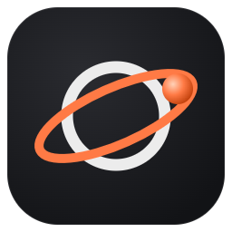
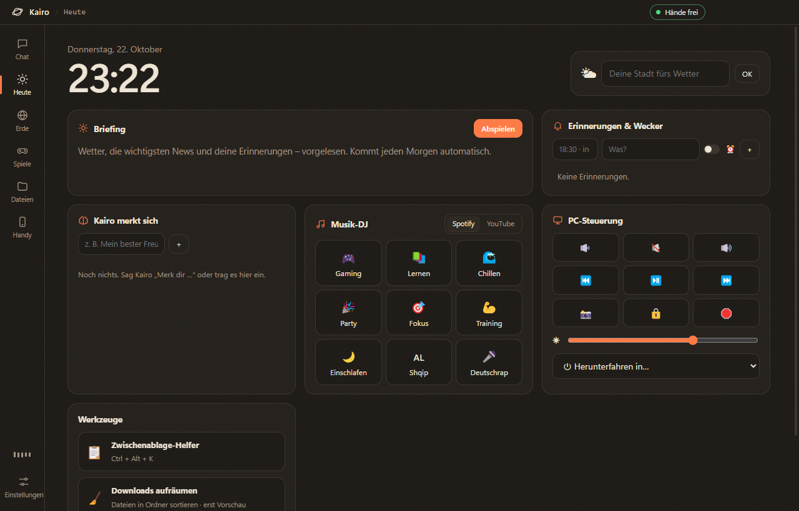
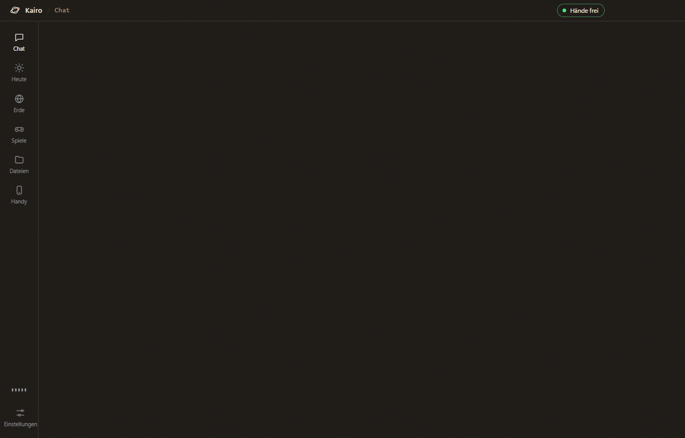
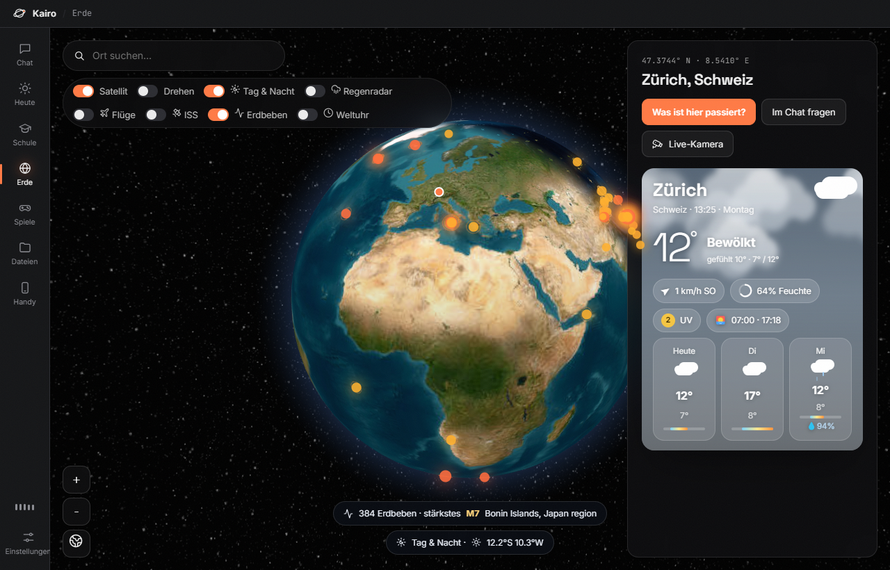
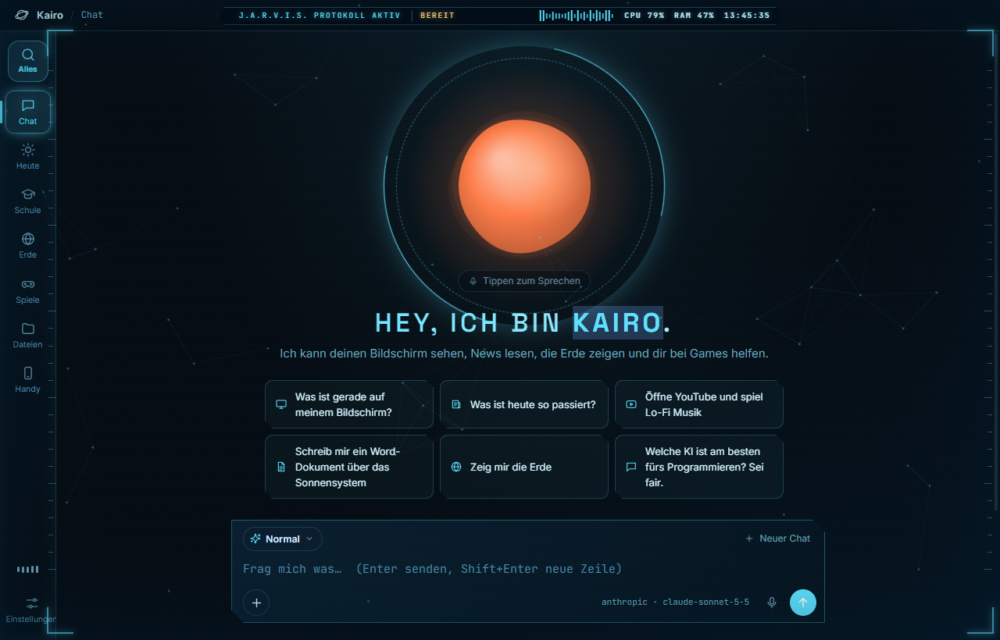
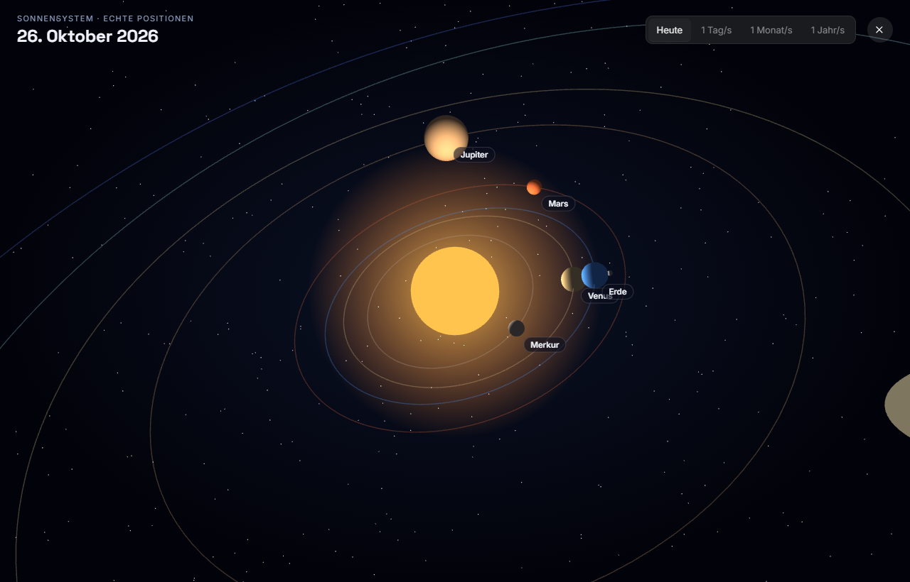
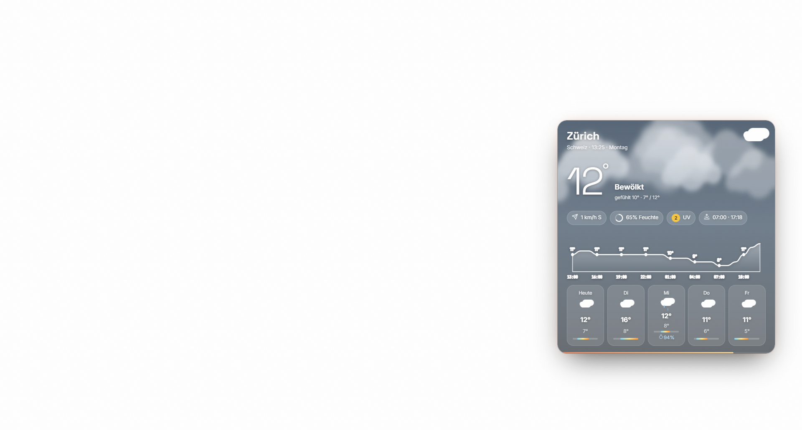
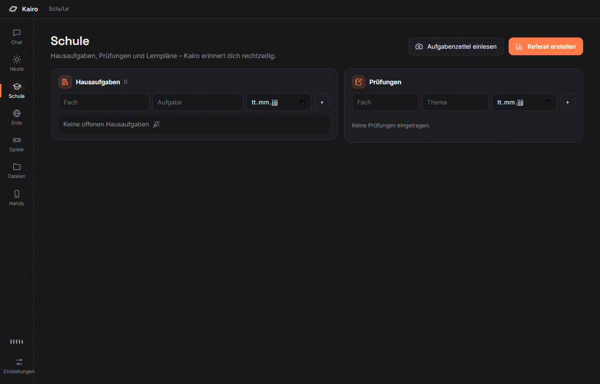

<div align="center">



# Kairo

**A desktop AI companion for Windows that talks, shows and does things.**
Hands-free voice, a cinematic 3D Earth, Jarvis mode, games, school help, a desktop pet and a lot more.
Works with Gemini (free), Claude, GPT or a local model.

[**⬇ Download for Windows**](https://github.com/eronrexhepi1234-tech/kairo/releases/latest/download/Kairo-Setup.exe) · [Website](https://eronrexhepi1234-tech.github.io/kairo/)



</div>

## Preview

| | |
|---|---|
|  |  |
| **Chat & voice** – type or just talk, Kairo answers out loud | **3D Earth** – live weather, earthquakes, day/night, flights, ISS |
|  |  |
| **Jarvis mode** – a holographic HUD over your desktop (`Ctrl+Shift+J`) | **Solar system** – real planet positions today |
|  |  |
| **Animated weather** – also on the desktop while Kairo is minimized | **Games** – chess vs Stockfish, GeoGuessr, quiz, riddles, game maker |

## Install

**Easy way:** [**Download Kairo-Setup.exe**](https://github.com/eronrexhepi1234-tech/kairo/releases/latest/download/Kairo-Setup.exe) and run it – a welcome setup guides you through the rest. Kairo updates itself when a new version is out.

Or visit the download page: **https://eronrexhepi1234-tech.github.io/kairo/**

> Windows may say *"Windows protected your PC"* because Kairo is new and not code-signed. Click **More info → Run anyway**.

**From source** (needs [Node.js](https://nodejs.org) 20 or newer):

```bash
npm install
npm start
```

## Setup in 2 minutes

1. Open **Settings → AI**, paste an API key and press **OK**:
   - **Google Gemini** – free, recommended (also needed for voice mode): https://aistudio.google.com/apikey
   - Anthropic Claude: https://console.anthropic.com/settings/keys
   - OpenAI: https://platform.openai.com/api-keys
   - Free & local: install [Ollama](https://ollama.com), run `ollama pull llama3.2`, then pick **Local / other**.
2. **Settings → Profile**: your name, your city (for weather) and how Kairo should call you.
3. **Settings → Voice**: pick a voice or a character voice (narrator, pirate, movie trailer …) and switch **hands-free** on or off.
4. Optional:
   - **Phone app** – page *Handy*: scan the QR code (same Wi-Fi), then *Add to home screen*.
   - **Phone alerts** – *Settings → Phone & calls*: push messages via the free [ntfy](https://ntfy.sh) app, or calls via Telegram.
   - **E-mail** – *Settings → E-mail*: connect your inbox with an app password (read-only).

Keys and passwords are encrypted with Windows DPAPI in `%APPDATA%\Kairo\settings.json` and only sent to the service you picked.

| Command | What it does |
|---|---|
| `npm start` | Run Kairo from the source folder |
| `npm run shortcut` | Add Kairo to the desktop and Start menu |
| `npm run dist` | Build the installer into `dist/` |
| `npm run icon` | Re-render the app icon |
| `KAIRO_DEV=1 npm start` | Developer mode: reloads when files change |

## Features

### Talk
| | |
|---|---|
| **Hands-free voice** | Speech-to-speech with Gemini Live. Just talk; interrupt any time. `Ctrl+Shift+K` from anywhere. |
| **Orb mode** | Minimize Kairo to a small orb: it keeps listening, and answers fly out of the orb as animated cards. |
| **Character voices** | 13 roles – documentary narrator, movie trailer, sports commentator, pirate, robot, villain, superhero … |
| **Any AI** | Claude, GPT, Gemini or any OpenAI-compatible server (Ollama, LM Studio, OpenRouter, Groq …). |
| **Personalities** | Normal, Bro, Lock-in, Mentor, Butler, Teacher, Commentator, Pirate, Robot – plus your own instructions. |
| **Languages** | Deutsch, English, Shqip, Français, Español, Italiano, Türkçe. |

### See
| | |
|---|---|
| **3D Earth** | Real satellite imagery, cinematic flights down to street level, country profiles, live webcams, world tours, world clock. |
| **Live layers** | Rain radar, day/night with city lights, planes with routes, ISS with orbit, earthquakes this week. |
| **Flight tracker** | Type a flight number (e.g. `LX8`) and follow it live with arrival time. |
| **Documentaries** | "Make a documentary about the Titanic" – narrator, photos, flights to the real places. |
| **What if…?** | "What if the moon disappeared?" – an animated story. |
| **Solar system** | Real planet positions, distances, light time, time-lapse. |
| **Show centre** | Jarvis mode, desktop pet, radio morning show with two hosts, wake-up show, weather and fireworks on the desktop, world TV, music quiz. |

### Create
| | |
|---|---|
| **Game maker** | "Make a game where a dragon dodges meteors" – Kairo codes it and you can play right away. |
| **Logo & banner maker** | 3 logo concepts plus YouTube, Discord and X banners and a profile picture. |
| **Minecraft planner** | Describe a build → 3D preview layer by layer, building steps and `/fill` commands. |
| **Inventor mode** | Turn an idea into a plan: names, features, steps, costs, risks, PDF or PowerPoint. |
| **Social Studio** | Kairo makes vertical TikTok / YouTube Shorts videos about itself (voice, animations, captions). You upload them. |
| **Documents** | PDFs, Word files, PowerPoint presentations, pictures, prompts for other AIs. |

### Everyday
| | |
|---|---|
| **Today page** | Weather, briefing, reminders & alarms, countdowns, birthdays, world clock, on this day in history. |
| **Super search** | `Alt+Space` anywhere: files, folders, programs, Windows settings, calculator. |
| **School** | Homework, exams with study plans, flashcards, PDF reading, quiz. |
| **Phone app** | Chat, PC control, your screen, alerts; Kairo calls you when new mail or a birthday comes up. |
| **E-mail** | New-mail notices and summaries (read-only, nothing is ever sent or deleted). |
| **PC tools** | Volume, media keys, PC check, tidy up downloads, read aloud, clipboard helper, clip mode. |

### Games
Chess vs Stockfish (with real-game analysis from Lichess/Chess.com), GeoGuessr, music quiz with real charts, riddles and jokes, voice changer, game coach, Tic-Tac-Toe, Connect Four.



## Publishing a release

1. Create an empty repository called `kairo` on GitHub.
2. `node scripts/set-github.js <your-github-name>` (points auto-update and links to your repo).
3. Push the code, then tag a version: `git tag v1.0.0` and `git push --tags`.
4. GitHub Actions builds `Kairo-Setup-1.0.0.exe` and publishes it as a release. Installed copies update themselves.

## Fair play

The game coach and the analysis help you learn. Kairo never plays with **your** account on chess.com,
Lichess or in other online games. The Lichess bot uses its own account that Lichess marks as a BOT.

## Privacy

- Kairo only runs while its window or mini orb is open. Nothing starts with Windows unless you turn it on.
- Hands-free listening runs locally; audio goes to Gemini only after someone starts speaking.
- Kairo hides its own window from its screenshots.
- Sending, buying, posting and installing always need your own click.
- The phone app only answers devices on your home network and needs a secret link.
- Phone alerts only contain short info like "5 new mails", never the content of your mail.

## Project layout

```
src/main/        Electron main process (windows, AI providers, features)
src/renderer/    the app UI (plain HTML/CSS/JS, no build step)
src/mobile/      the phone web app
scripts/         icons, desktop shortcut, GitHub setup
docs/            screenshots
```

## Credits

Chess engine [Stockfish.js](https://github.com/nmrugg/stockfish.js) (GPLv3) with [chess.js](https://github.com/jhlywa/chess.js).
Globe by [globe.gl](https://github.com/vasturiano/globe.gl), satellite tiles © Esri World Imagery, 3D by [three.js](https://threejs.org),
planet positions by [Astronomy Engine](https://github.com/cosinekitty/astronomy). Weather by [Open-Meteo](https://open-meteo.com),
rain radar by [RainViewer](https://www.rainviewer.com), earthquakes by USGS, flights by OpenSky / adsb.lol / adsbdb,
photos from Wikimedia Commons. Place names © OpenStreetMap contributors. Icons by [Lucide](https://lucide.dev).

## License

MIT (Stockfish keeps its own GPLv3 license).
