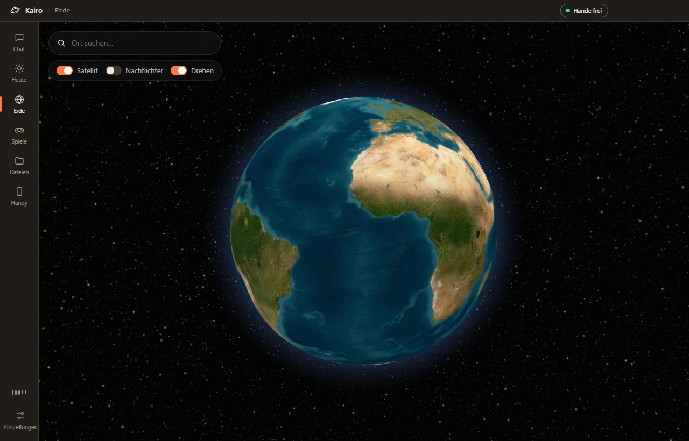

# Kairo

A desktop companion for Windows. Talk to it hands-free or type. It answers with Claude, GPT,
Gemini or a local model, looks at your screen, reads today's news, flies around a satellite Earth,
plays chess with Stockfish, sets reminders and alarms, controls your PC and much more.


## Install

**Easy way:** download `Kairo-Setup-x.y.z.exe` from the [Releases page](https://github.com/YOUR_GITHUB_NAME/kairo/releases) and run it. It updates itself when a new version is out.

**From source:** you need [Node.js](https://nodejs.org) 20 or newer.

```bash
npm install
npm start
```

Then open **Settings → AI**, paste an API key and press **OK**:

- Google Gemini (free tier, needed for voice mode): https://aistudio.google.com/apikey
- Anthropic: https://console.anthropic.com/settings/keys
- OpenAI: https://platform.openai.com/api-keys
- Free & local: install [Ollama](https://ollama.com), run `ollama pull llama3.2`, then pick **Local / other**.

Keys are encrypted with Windows DPAPI in `%APPDATA%\Kairo\settings.json` and only sent to the provider you picked.

| Command | What it does |
|---|---|
| `npm start` | Run Kairo from the source folder (reloads itself when files change) |
| `npm run shortcut` | Add Kairo to the desktop and Start menu |
| `npm run dist` | Build the installer into `dist/` |
| `npm run icon` | Re-render the app icon |

## Features

### Talk & chat
| | |
|---|---|
| **Hands-free voice** | Kairo listens from the start: just say "Hey". The mic is checked on your PC; nothing is sent until you speak. Speech-to-speech with Gemini Live, natural voices, you can interrupt anytime. `Ctrl+Shift+K` from anywhere. |
| **Orb or face** | Animated orb in 4 styles (Orb, Particles, Rings, Wave) or 4 faces (cute, robot, cat, minimal) that blink, follow your mouse and talk. 6 colour palettes. A mini orb floats on screen while Kairo is minimized. |
| **Webcam** | "Look at me", "What am I holding?", homework on paper — Kairo can see through your webcam in voice mode. |
| **Live translator** | Two people, two languages: Kairo interprets every sentence out loud (e.g. German ⇄ Albanian). |
| **Any AI** | Claude, GPT, Gemini, or any OpenAI-compatible server (Ollama, LM Studio, OpenRouter, Groq, Mistral, xAI). Busy or slow models are skipped automatically. |
| **Personalities** | Normal, Bro, Lock-in (focus timer), Mentor, Butler, Language teacher, Sports commentator, Pirate, Robot — plus your own instructions. |
| **Memory** | "Remember that my best friend is called Arben" — Kairo keeps it across chats. |
| **Fresh answers** | Google Search for anything current, live Swiss/German/… news, live weather, Epic Games free games. |
| **Languages** | Deutsch, English, Shqip, Français, Español, Italiano, Türkçe. |
| **Style** | 8 themes (Graphite, Paper, Terminal, Ocean, Sand, Midnight, Forest, Rose), any accent colour, 3 font styles, animated backgrounds (stars, aurora, rain, waves). |

### Does things
| | |
|---|---|
| **Smart Home** | Philips Hue, WiZ, Govee, Yeelight, LIFX and Home Assistant (covers Tuya / Smart Life / IKEA). Finds lamps in your Wi-Fi, scenes (Gaming, Study, Movie, Party, …), "make the light purple". Demo lamp to try it without hardware. |
| **Today page** | Clock, weather, daily briefing (read aloud every morning), reminders & alarms, memory, music DJ, PC controls. |
| **Reminders & alarms** | "Remind me in 20 minutes about the pizza", "Wake me up at 7" — with sound, snooze and Windows notifications. |
| **Open things** | Websites, YouTube searches, apps (Spotify, Discord, Steam, …), WhatsApp messages (you press send), Steam install dialogs (you confirm), Spotify searches. |
| **Files** | Writes Word (.docx), text, Markdown, HTML, CSV or code files into `Documents\Kairo`. |
| **PC control** | Volume, media keys, brightness (laptops), screenshot, lock, sleep, shutdown timer. |
| **Tidy up Downloads** | Sorts files into folders after showing a preview. One click to undo. |
| **Read aloud** | Text, web pages or Word files read with a natural voice, sentence by sentence. |
| **Flashcards** | Cards from a topic, copied text or your screen, with spaced repetition. |
| **Clip mode** | Saves the last ~30 s of your screen with `Ctrl+Alt+C` or "clip that". Off unless you switch it on. |
| **Screen time** | How long games, videos, learning apps and chats were open today (only while Kairo runs, stays on your PC). |
| **Clipboard helper** | Copy any text, press `Ctrl+Alt+K`: translate, shorten, make friendlier, fix spelling, explain, write a reply. |
| **Sees your screen** | "What's on my screen?", "Where is this?" (finds the place, researches clues, shows it on the Earth), homework help step by step. |
| **Earth** | 3D globe with real satellite imagery; click a place → "What happened here?" |
| **Phone remote** | Scan a QR code (same Wi-Fi): chat, see your screen, lock/sleep, media and volume keys. |

### Games
| | |
|---|---|
| **Chess** | Play Stockfish (levels 1–20), evaluation bar, hints, "Kairo plays for me", Kairo vs Kairo, explain the position. By voice: "Knight to f3". |
| **Game analysis** | Load your real games from Lichess or Chess.com: accuracy, blunders, mistakes, the better move on the board, and Kairo explains your mistakes. |
| **Lichess bot** | Kairo plays live on lichess.org with its own official BOT account — challenge it or let it play other bots. |
| **Quiz** | Any topic, 10 questions against the clock, streak bonus, read aloud. |
| **Game coach** | GeoGuessr (country + coordinates), chess, Minecraft, Wordle, Sudoku, strategy games — optional overlay on top of the game. |
| **Mini games** | Tic-Tac-Toe and Connect Four against Kairo. |





## Publishing a release

1. Create an empty repository called `kairo` on GitHub.
2. `node scripts/set-github.js <your-github-name>` (points auto-update and links to your repo).
3. Push the code, then tag a version: `git tag v0.3.0` and `git push --tags`.
4. GitHub Actions builds `Kairo-Setup-0.3.0.exe` and publishes it as a release. Installed copies update themselves.

## Fair play

The game coach and the analysis help you learn. Kairo never plays with **your** account on chess.com,
Lichess or in other online games — engine help in your own games is cheating and gets accounts banned.
The Lichess bot uses its own account that Lichess marks as a BOT, which is allowed.

## Privacy

- Kairo only runs while its window is open: closing it ends it, and nothing starts with Windows unless you turn that on.
- Hands-free listening runs locally; audio goes to Gemini only after someone starts speaking, and voice mode closes after 40 s of silence.
- Kairo hides its own window from its screenshots.
- Sending, buying and installing always need your own click (WhatsApp, Steam, e-mail).
- The phone remote only answers devices on your home network and needs a secret link.

## Turning the PC on from your phone

A PC that is off can't run Kairo. Use Wake-on-LAN: enable it in BIOS/UEFI and in the network adapter
(Device Manager → adapter → "Wake on Magic Packet"), then use any Wake-on-LAN app with the MAC address
shown on the Phone page. This usually only works over Ethernet.

## Project layout

```
src/main/        Electron main process
  main.js        windows, IPC, hotkeys
  providers.js   Claude / GPT / Gemini / OpenAI-compatible streaming, fallbacks, voices
  agent.js       picks context: screen, news, weather, web search, clipboard, folder
  persona.js     system prompt, personalities, memory
  features.js    memory, reminders, briefing, PC control, tidy-up, clipboard helper
  chess.js       chess game vs Stockfish     analysis.js  real-game analysis
  lichess.js     Lichess bot                 system.js    tray, autostart, live reload
src/renderer/    the app UI (plain HTML/CSS/JS, no build step)
src/mobile/      the phone web app
scripts/         icon + desktop shortcut
```

## Credits

Chess engine: [Stockfish.js](https://github.com/nmrugg/stockfish.js) (GPLv3) with rules from [chess.js](https://github.com/jhlywa/chess.js).
Globe by [globe.gl](https://github.com/vasturiano/globe.gl). Satellite tiles © Esri World Imagery.
Weather by [Open-Meteo](https://open-meteo.com). Place names © OpenStreetMap contributors. News via Google News RSS.

## License

MIT (Stockfish keeps its own GPLv3 license).

